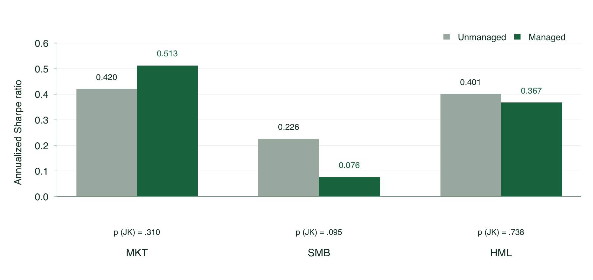

# Can Volatility Management Beat the Market?

**Marcus Maraia | STAT 5200: Applied Econometrics I (Fall 2026) | University of Pennsylvania**

A restricted replication of Cederburg, O’Doherty, Wang, and Yan (2020), *On the Performance of Volatility-Managed Portfolios*, using the market (MKT), size (SMB), and value (HML) factors.

**Question:** Does reducing factor exposure after volatile months improve performance when investment decisions must use information available at the time?

The project establishes a historical benchmark for studying volatility management after trading costs and leverage limits. This repository covers the replication assignment, with one preliminary extension connecting it to the proposed research question.

## Contents

- [Presentation and findings](#presentation-and-findings)
- [Data](#data)
- [Methods](#methods)
- [Technology and reproduction](#technology-and-reproduction)
- [Repository structure](#repository-structure)
- [Limitations and lessons](#limitations-and-lessons)
- [References and credits](#references-and-credits)

## Presentation and findings

- [Presentation PDF](presentation/Volatility_Management.pdf): 10 main pages and two backup appendices.
- [Results summary](reports/RESULTS.md), [tables](results/tables/), and [inference](results/inference/).
- [Replication audit](reports/REPLICATION_AUDIT.md): implementation decisions, verification, and limitations.



| Historical result | MKT | SMB | HML |
| --- | ---: | ---: | ---: |
| Original Sharpe | 0.420 | 0.226 | 0.401 |
| Managed Sharpe | 0.513 | 0.076 | 0.367 |
| Annualized spanning alpha (%) | 4.607 | -0.749 | 1.753 |
| Real-time original-only Sharpe | 0.458 | 0.187 | 0.442 |
| Real-time combination Sharpe | 0.415 | 0.128 | 0.375 |

Market spanning alpha is significant under White HC0 inference. None of the three direct or real-time Sharpe differences is significant at 5% under the paper-aligned tests. Historical alpha and implementable performance are therefore distinct findings.

## Data

Daily and monthly U.S. three-factor returns come from the [Kenneth R. French Data Library](https://mba.tuck.dartmouth.edu/pages/faculty/ken.french/data_library.html). MKT is the market excess return; SMB and HML are long-short size and value returns. Source percentages are converted to decimals.

The preserved raw archives identify the **September 2026 CRSP database vintage**. Their [provenance](data/raw/README.md) is documented, and they reproduce the included processed snapshot.

| Exercise | Period |
| --- | --- |
| Historical replication | August 1926–December 2016; 1,085 months |
| Real-time evaluation | August 1936–December 2016; 965 months after 120 training months |
| Preliminary extension calibration | July 1963–December 2018 |
| Preliminary extension evaluation | January 2019–December 2025; 84 months |

## Methods

- **Portfolio construction:** estimate variance as 22 times mean squared daily returns, without demeaning. Its inverse determines the following month’s exposure, avoiding look-ahead in the signal.
- **Table 1:** match historical full-sample volatilities and compare stand-alone Sharpe ratios.
- **Selected Table 3 Panel A results:** use OLS spanning regressions and White HC0 inference to assess historical alpha beyond each original factor.
- **Selected Table 5 Panel A results:** estimate allocations recursively using past observations, risk aversion of 5, and the main text’s total-factor-exposure limit of 5.
- **Inference:** historical Sharpe tests follow Jobson–Korkie with the Memmel correction; CER tests use the paper’s DeMiguel et al. normal approximation.
- **Preliminary extension:** fix pre-2019 scaling, cap exposure at 2, and charge 10 basis points per unit of exposure change. Its paired 12-month block bootstrap uses 5,000 replicates and seed 5200; it is separate from the published historical tests.

## Technology and reproduction

**Base R, tested with R 4.4.2**, handles preparation, estimation, inference, checks, charts. No contributed R packages or Python installation are required. CSV and Markdown keep the results portable and readable.

From the repository root:

```bash
Rscript scripts/run_all.R
```

This works offline with the included raw archives and regenerates the analysis, five green charts, and computed slide inputs. Charts read the result CSVs rather than embedded numerical arrays.

To skip raw reconstruction:

```bash
Rscript scripts/run_all.R --from-processed
```

See the [validation record](reports/validation.txt) and [R environment](reports/sessionInfo.txt). Raw and processed-data routes agree within numerical tolerance.

The optional slide source uses LaTeX, Beamer, and TikZ. With the required TeX packages installed:

```bash
bash scripts/build_slides.sh
```

LaTeX is unnecessary for running the analysis or viewing the existing PDF.

## Repository structure

| Path | Purpose |
| --- | --- |
| `R/` | Preparation, analysis, inference, charts, document generation, and checks |
| `scripts/` | Main R entry point and optional slide build helper |
| `data/` | Preserved raw archives, provenance, and processed snapshot |
| `results/` | Tables, comparisons, strategy paths, inference, and figures |
| `presentation/` | Slide PDF and editable source |
| `reports/` | Results, audit, validation, and environment information |
| `.gitignore` | Excludes temporary files |

## Limitations and lessons

This is a **three-factor replication of selected results**, not the full 103-strategy study. Structural-break tests and additional-control panels are outside its scope.

The data vintage differs from the publication’s, so numerical equality is not claimed. The audit explains the paper’s differing leverage descriptions and the implemented rule.

HC0 does not correct serial correlation; historical tests use normal approximations. Extension inference is exploratory, conditional on generated paths, and unadjusted for multiple comparisons. Costs are factor-exposure proxies, and drawdowns compound excess returns rather than complete investor wealth.

The main lessons are to track units and vintages, lag signals, distinguish hindsight from real-time decisions, and separate alpha, Sharpe improvement, and risk reduction.

## References and credits

- Cederburg et al. (2020). *On the Performance of Volatility-Managed Portfolios*. Journal of Financial Economics, 138(1), 95–117. [Paper](https://www.lehigh.edu/~xuy219/research/COWY.pdf).
- Moreira and Muir (2017). *Volatility-Managed Portfolios*. Journal of Finance, 72(4), 1611–1644. [DOI](https://doi.org/10.1111/jofi.12513).
- Kenneth R. French: [factor data](https://mba.tuck.dartmouth.edu/pages/faculty/ken.french/data_library.html).

Course replication by Marcus Maraia. This repository uses a separate R implementation of the published methods; the paper authors’ original code is not included. Charts are generated from the replication results. 
